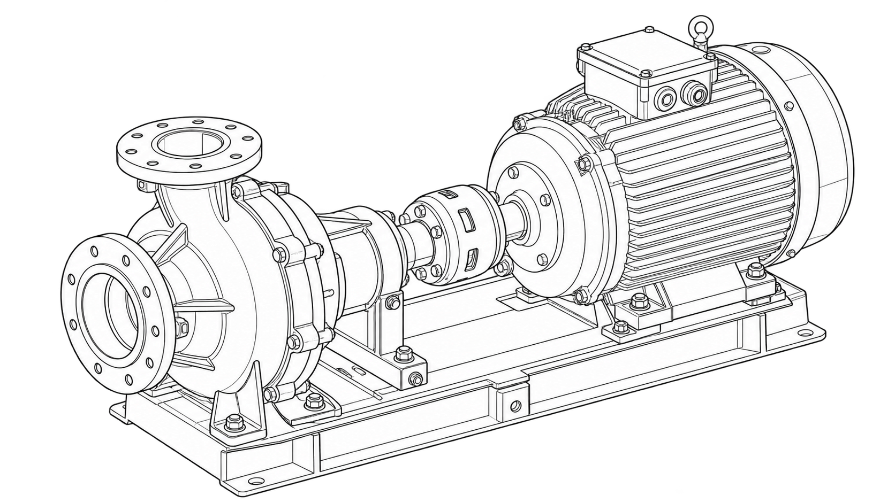
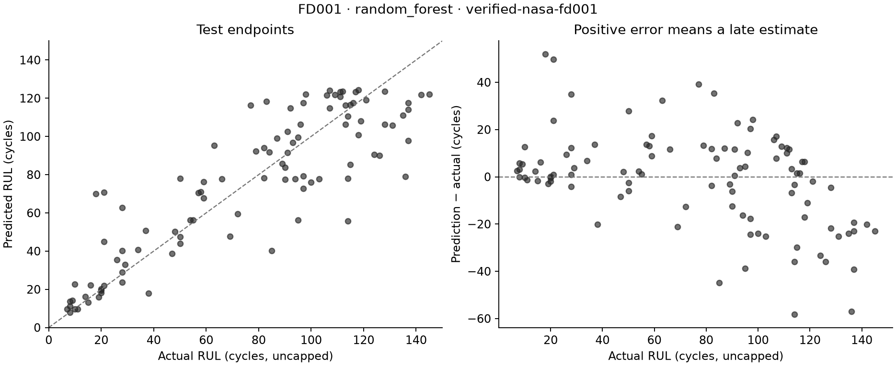

# Predictive Maintenance



*Generated line-art concept illustration.*

A reproducible remaining-useful-life experiment on NASA's **simulated C-MAPSS FD001 engine data**. It compares baselines and tree models, selects a model on held-out engines, and evaluates that model on the official test endpoints.

The first recorded run selected Random Forest: **20.21 cycles RMSE and 14.92 cycles MAE** against uncapped test RUL, across 100 engines. These are measured benchmark errors. They are not a failure guarantee or results from real equipment. Exact inputs and results are in [the recorded run](docs/results/2026-10-27/metrics.json).



## Reproduce

Use Python **3.12 or newer**. The benchmark used Python 3.12.14. A CPU is sufficient; no account, API key, or GPU is required.

On macOS, the optional XGBoost wheel also needs the OpenMP runtime: `brew install libomp`. Windows needs the Visual C++ runtime. See [XGBoost's installation guide](https://xgboost.readthedocs.io/en/stable/install.html). CI installs OpenMP on its macOS runners. The base installation without `--xgboost` does not require this XGBoost dependency.

```sh
git clone https://github.com/ungaaaabungaaa/predictive-maintenance.git
cd predictive-maintenance
python -m venv .venv
# macOS/Linux:
source .venv/bin/activate
# Windows PowerShell: .venv\Scripts\Activate.ps1
python -m pip install -r requirements-benchmark.txt
python -m pip install -e . --no-deps
maintenance-lab download
maintenance-lab run --xgboost --output artifacts/fd001
```

Open `artifacts/fd001/report.html` in a browser. The run also writes metrics, predictions, and two plots. Choose a new output folder for each run; existing results are never overwritten. Downloading is explicit and stores only the three required FD001 text files, about 5.7 MB. Training runs offline after that.

For a smaller installation without XGBoost or test tools, use `python -m pip install .` and omit `--xgboost`. The [notebook](notebooks/reproduce.ipynb) calls the same package functions.

## Experiment

1. Verify SHA-256 hashes for the NASA-linked archive, nested archive, and selected data files.
2. Validate finite sensor data, complete cycle sequences, and test RUL offsets.
3. Split the 100 training engines into 80 fit engines and 20 validation engines. All cycles from one engine stay in one group.
4. Build current readings, trailing means, and trailing deltas from readings available at each cycle. Exclude unit ID from the model.
5. Compare a mean baseline, Ridge, Random Forest, and optional XGBoost. Choose by validation RMSE on one seeded truncated snapshot per validation engine.
6. Refit the selected model on all training engines. Read official test RUL only after fitting, then score one endpoint per test engine.

The training target is capped at **125 cycles**. Predictions are clipped to 0–125. The report gives both capped and uncapped test metrics and the observation count for each. Changing the cap changes the task. See [methodology](docs/methodology.md).

| Model | Validation RMSE, capped cycles | Validation MAE, capped cycles |
| --- | ---: | ---: |
| Mean baseline | 33.77 | 27.76 |
| Ridge | 22.51 | 18.80 |
| Random Forest, selected | 16.90 | 12.82 |
| XGBoost | 17.59 | 14.11 |

The selected model's test RMSE is **19.08 cycles against capped RUL**, and **20.21 cycles against uncapped RUL**. Each test metric uses 100 endpoint observations. Model choice uses the 20 validation observations only.

## Maintenance labels

Illustrative bands are `inspect` at 20 predicted cycles or less, `plan` at 50 or less, and `monitor` above 50. The RUL index is `100 × predicted RUL / cap`, clipped to 0–100. These are **heuristic labels**, not calibrated failure probabilities, measured equipment health, or maintenance instructions.

This educational benchmark uses simulated engines. It does not model operating hours, inspection costs, new engine types, field drift, or uncertainty. It has no physical equipment interface and is not an operational safety system.

## Check the code

```sh
python -m pip install -e '.[dev,xgboost]'
python -m ruff check src tests
python -m pytest --cov --cov-branch --cov-report=term-missing
python -m build
```

Tests cover invalid trajectories, archive integrity and reuse, input limits, past/current feature prefixes, engine isolation, metric formulas, model selection, output preservation, and the report/CLI workflow. CI runs on Linux, macOS, and Windows. CI uses small synthetic fixtures. The recorded benchmark uses verified NASA files.

## Data and provenance

NASA lists this dataset on the [PCoE data repository](https://www.nasa.gov/intelligent-systems-division/discovery-and-systems-health/pcoe/pcoe-data-set-repository/). The contributors are A. Saxena and K. Goebel (2008). Cite the original run-to-failure modeling paper by Saxena, Goebel, Simon, and Eklund, PHM 2008. See [data provenance and hashes](docs/data.md).

Raw data are downloaded separately. The MIT license covers this project's new code, not the dataset or NASA marks. NASA's metadata does not specify a dataset license. The code license does not grant data redistribution rights.

The portfolio's linked Colab notebook and Medium article could not be accessed during this build. Their contents and earlier results were not verified. This implementation and its result files were created on **27 October 2026**. See [source review](docs/source-review.md).

## Repository history

This repository was `Data_Science_projects`. Its earlier fake-news examples remain on [archive/before-predictive-maintenance-2026-10-27](https://github.com/ungaaaabungaaa/predictive-maintenance/tree/archive/before-predictive-maintenance-2026-10-27), at `27b972635037dee8a5260b2806df28c3228cae28`. Existing stars and earlier commits predate this project.

See [CONTRIBUTING](CONTRIBUTING.md), [SECURITY](SECURITY.md), and [LICENSE](LICENSE).
